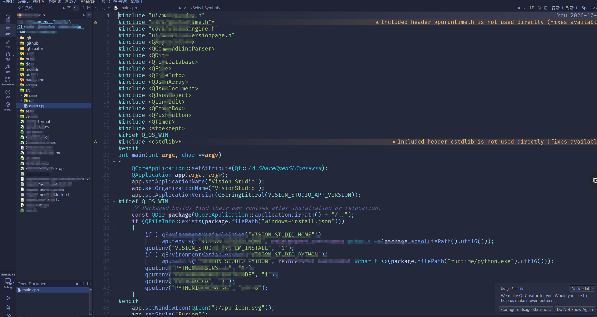

### 1、配色方案

##### 1.1、先下载配置文件。

##### 1.2、然后拷贝到QtCreator安装目录下的`QtCreator\share\qtcreator\styles`目录下。

##### 1.3、重启 Qt Creator。

##### 1.4、打开 **工具 → 选项 → 文本编辑器 → 字体和颜色**，最上面那个下拉框（标题是"配色方案"）。

### 2、界面主题

##### 1.1、先下载配置文件。

##### 1.2、然后拷贝到QtCreator安装目录下的`QtCreator\share\qtcreator\themes`目录下。

##### 1.3、重启 Qt Creator。

1.4、 `工具 → 选项 → 环境 → 界面 → 主题` 选 `Tokyo Night (Qt Creator)`。

效果如下

